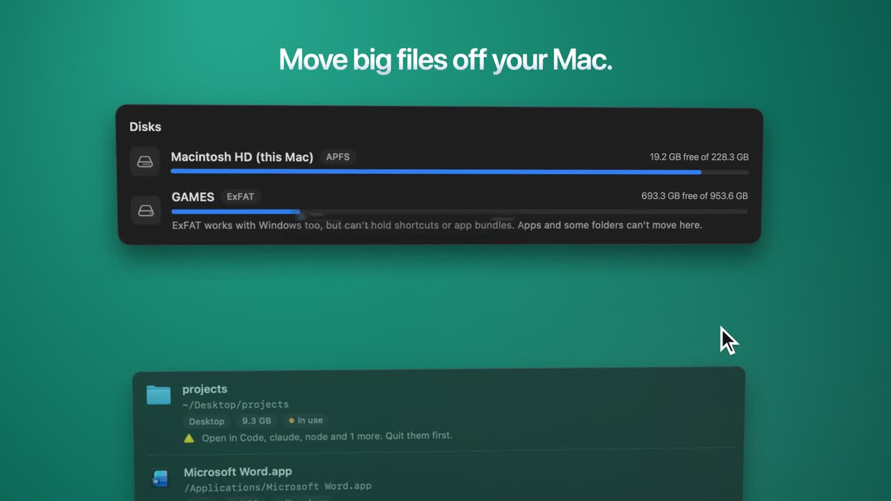
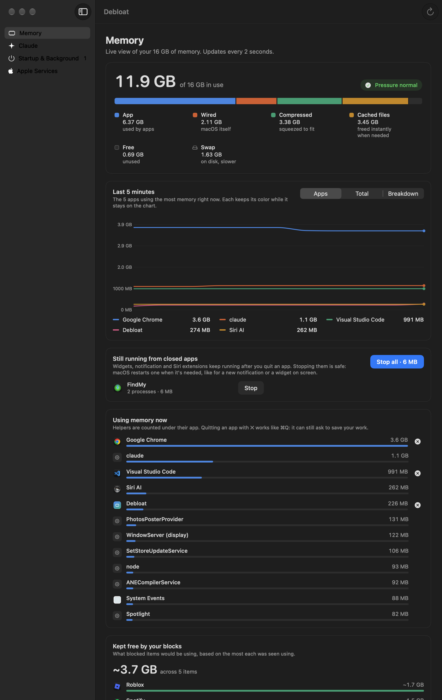
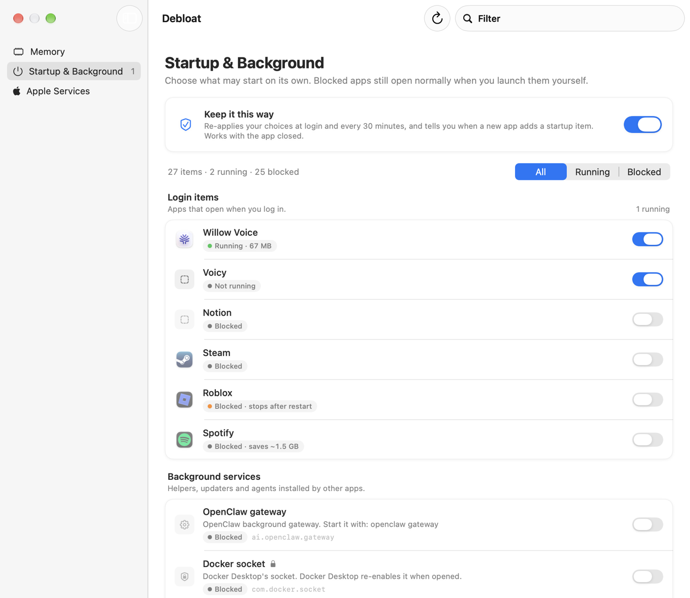
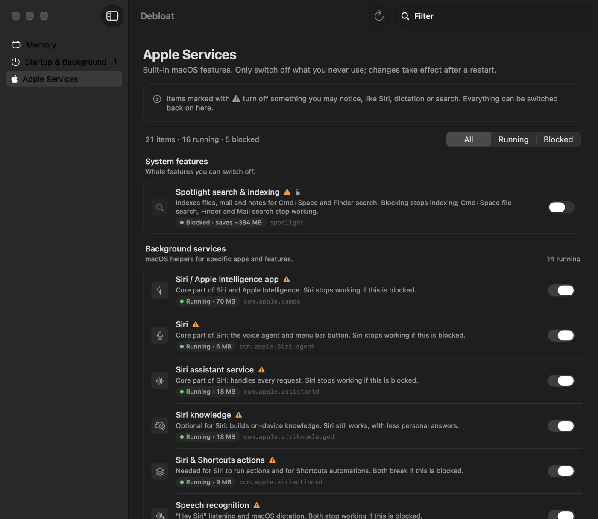
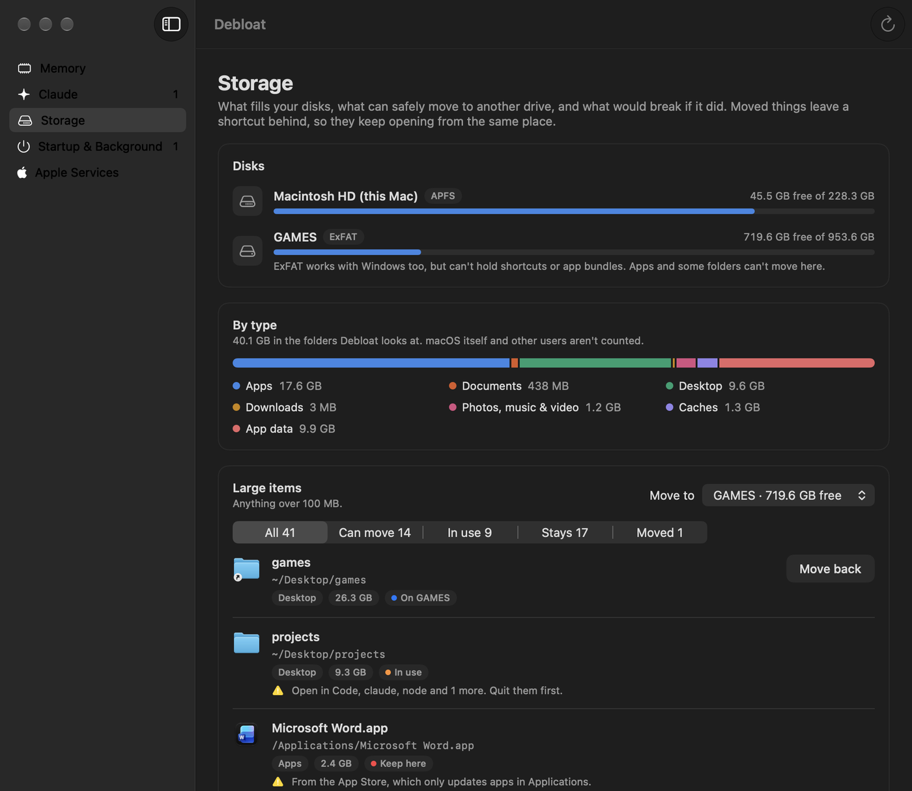
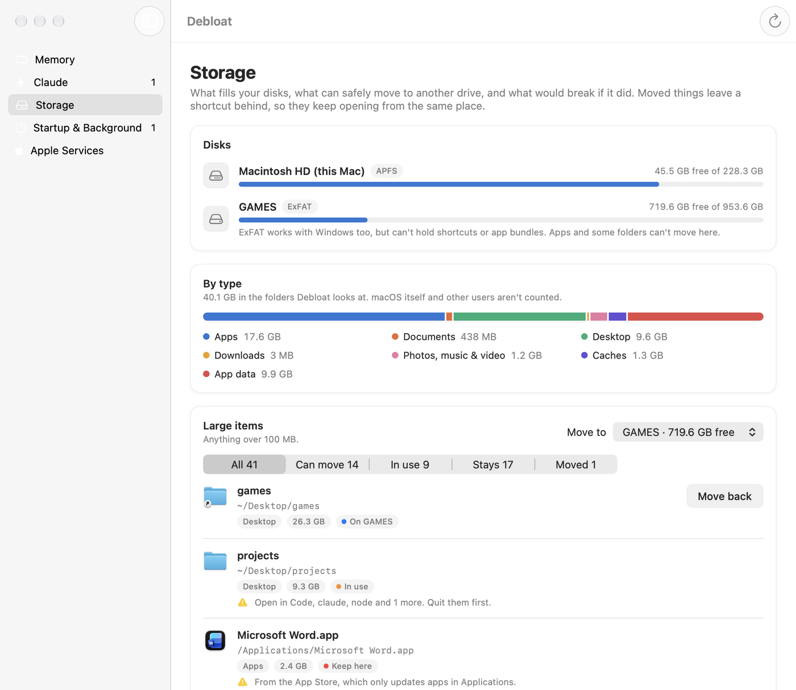
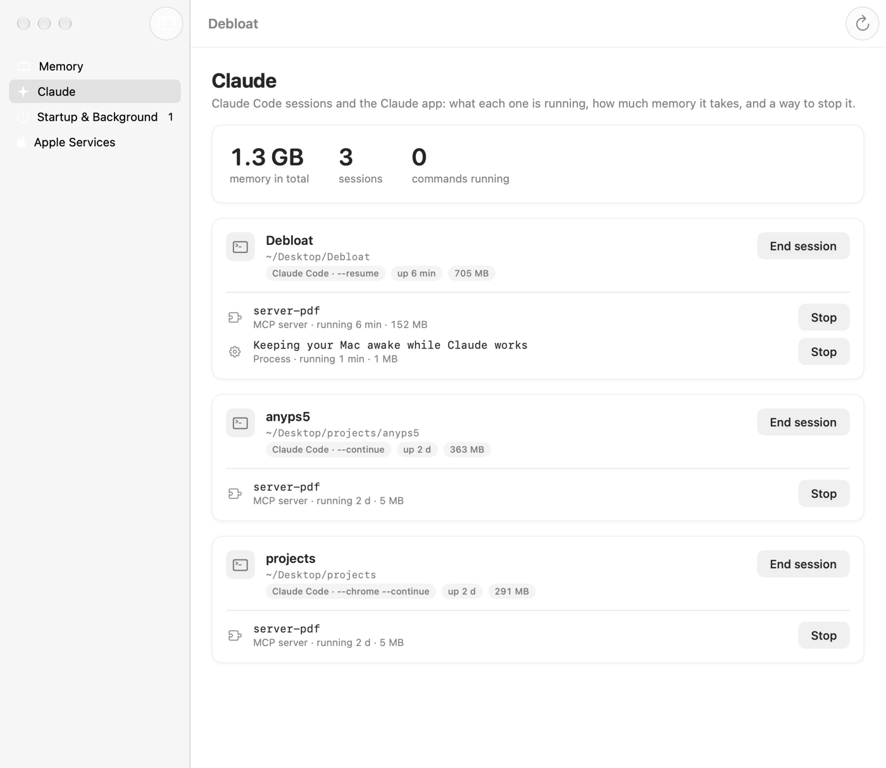
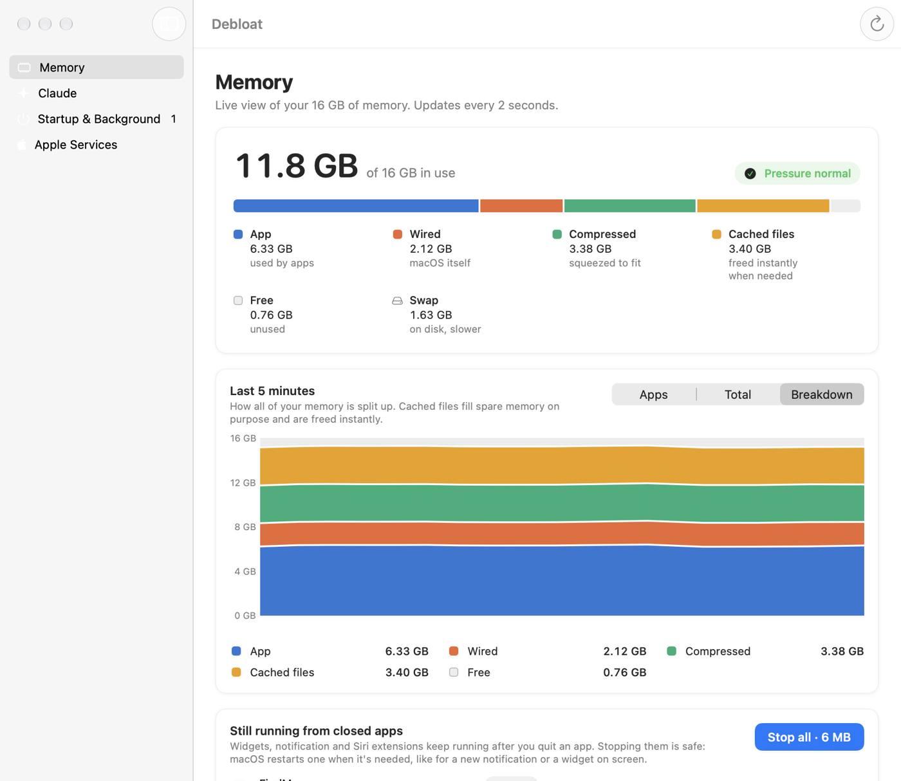
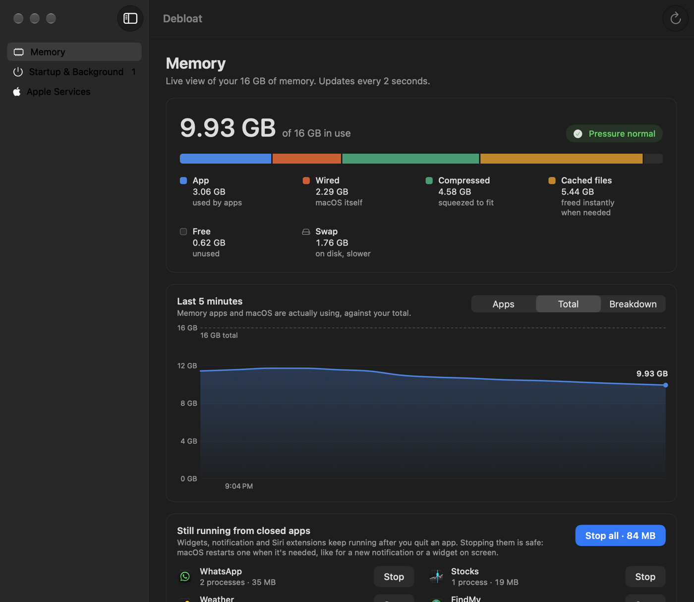

# Debloat

**See where your Mac's memory goes, switch off the startup items and background services you don't need, and keep them off — even after restarts and app updates.**

A small native macOS app (SwiftUI, macOS 14+, Apple Silicon + Intel) backed by a plain bash engine you can also use from the terminal. Nothing is ever uninstalled or deleted: every block is a reversible switch.

<p align="center">
  <a href="https://github.com/krishalivaibhav/Debloat/raw/main/docs/media/debloat-ad-1080p.mp4"></a><br>
  <sub>▶ <a href="https://github.com/krishalivaibhav/Debloat/raw/main/docs/media/debloat-ad-1080p.mp4">Watch the 40-second tour</a> · <a href="https://github.com/krishalivaibhav/Debloat/releases/tag/v1.1">download in 4K</a></sub>
</p>

<p align="center">
  
</p>

## What it does

- **Live memory view.** Usage every 2 seconds in Activity Monitor's terms (App, Wired, Compressed, Cached files, Free, Swap), memory pressure, and a 5-minute history you can hover — per app, as a total, or as a full breakdown.
- **Finds leftovers from closed apps.** Widgets, notification and Siri extensions keep running after you quit an app. Debloat lists them and stops them in one click (macOS restarts one if it's actually needed).
- **Quit memory-heavy apps.** The "Using memory now" list has a ✕ to quit any app in your Applications folder, the same as ⌘Q.
- **See what Claude is doing.** A Claude page lists Claude Code sessions and the Claude app, the shell commands and MCP servers each is running, and background commands left behind by sessions that ended — each with a Stop button.
- **Storage manager.** Shows each disk (APFS, ExFAT…) with its free space, what fills it by type (apps, documents, desktop, downloads, media, developer, caches, app data), and every item over 100 MB marked **Safe to move**, **In use** (naming the app that has it open), **Keep here** (with the reason) or **Moved**. It also flags what depends on an item: shell configs, login items and shortcuts that point at it. **Move** copies the item to an external drive, checks every file arrived, then leaves a shortcut so it still opens from the same place; **Move back** reverses it.
- **Startup & background control.** Every login item and every launch agent/daemon other apps installed, with whether it's running and how much memory it uses. Flip the switch off and it stops starting on its own; the app itself still opens normally.
- **Apple services, explained.** Spotlight indexing, Photos analysis, Music library, News, Game Center, Siri parts… each with a plain-English description. ⚠️ marks the ones that turn off something you'd notice.
- **Shows what you saved.** Blocked items remember the most memory they were seen using, so you can see roughly how much your blocks keep free.
- **Keeps it that way.** An optional tiny background job re-applies your choices at login and every 30 minutes, and notifies you when a new app sneaks in a startup item. Works with the app closed.

## Screenshots

| Startup & Background | Apple Services |
|---|---|
|  |  |

| Storage | Storage (light) |
|---|---|
|  |  |

| Claude | Memory breakdown |
|---|---|
|  |  |

| Total vs. capacity | |
|---|---|
|  | |

## Pages

| Page | What it shows |
|---|---|
| **Memory** | Live usage (updates every 2 s): a stacked bar and legend in Activity Monitor's terms, memory pressure, a 5-minute history chart you can hover, leftovers from closed apps, the apps using the most memory right now, and how much memory your blocks keep free |
| **Claude** | Every Claude Code session (folder, flags, uptime, memory) and the Claude app, with the commands and MCP servers each one is running. Stop a single command, end a whole session, or clean up commands left running after a session closed |
| **Storage** | Disks with format and free space, space by type, and large items with whether each can move, what's using it and what depends on it. Pick a drive, then **Move** (copy, verify, leave a shortcut), **Move back**, or **Delete** for caches |
| **Startup & Background** | Login items and background helpers from other apps. Switch **on** = allowed to start on its own, like System Settings' "Allow in the Background" |
| **Apple Services** | Built-in features (Spotlight) and macOS helpers (Siri, Photos analysis, Music library, News…). ⚠️ marks ones that turn off something you'd notice |

Every row shows whether the item is running, how much memory it uses now, or, if blocked,
roughly how much it would use. Filter a page by text or by **All / Running / Blocked**.
Changes collect in a bar at the bottom until you hit **Apply** (or **Revert**). 🔒 items ask for your Mac password when applied.

**Shortcuts:** ⌘1–⌘5 switch pages, ⌘R rescans, Return applies pending changes.

## Install

Download `Debloat.zip` from [Releases](../../releases), unzip, and move **Debloat.app** to Applications.
It isn't notarized, so the first time: right-click **Debloat.app → Open → Open**
(or `xattr -dr com.apple.quarantine /Applications/Debloat.app`).

## Build

Needs the Xcode Command Line Tools (`xcode-select --install`). Runs on macOS 14 or later.

```sh
./build.sh          # → build/Debloat.app and build/Debloat.zip (Apple Silicon + Intel)
```

To check the UI without screen-recording permission, render every page (dark and light) to PNGs:

```sh
build/Debloat.app/Contents/MacOS/Debloat --snapshot /tmp/debloat-snap
```

(Snapshots draw a plain stand-in for the sidebar: macOS can't render the real sidebar list offscreen.)

## Permissions

The first scan asks for permission to control System Events (needed to read login items).

## Command line

The app installs its engine to `~/.debloat/debloat`. You can also use it directly:

```sh
debloat scan                                  # list everything (link: ln -s ~/.debloat/debloat /opt/homebrew/bin/debloat)
debloat set agent com.google.keystone.agent block
debloat set feature spotlight block
debloat apply
debloat pending                               # system-level changes waiting for a password
sudo debloat system                           # apply them
debloat log
```

Config lives in `~/.debloat/config` (plain text, one rule per line).

## Project layout

```
Sources/DebloatApp.swift     Entry point, data model, window, pending-changes bar, toast
Sources/MemoryPage.swift     Memory page: overview bar, history chart, top processes, savings
Sources/StartupPage.swift    Startup & Background and Apple Services pages, rows, banners
Sources/Theme.swift          Colors, motion curves, button styles, cards, icons
Sources/ClaudePage.swift     Claude page: sessions, their running commands and MCP servers
Sources/ClaudeMonitor.swift  Finds Claude sessions and their child processes
Sources/StoragePage.swift    Storage page: disks, space by type, large items, move/move back
Sources/StorageMonitor.swift Measures folders, checks open files and references, moves items
Sources/MemoryMonitor.swift  Reads system memory and per-process usage
Sources/Engine.swift         Runs the shell engine and parses its scan output
Sources/Snapshot.swift       --snapshot mode for offscreen UI checks
Resources/debloat            The engine (bash): scan, apply, set, pending, system, install
Resources/catalog.tsv        Friendly names, descriptions and ⚠️ flags for known services
Resources/make-icon.swift    Draws AppIcon.icns (run by build.sh if missing)
build.sh                     Builds the universal .app and a .zip to share
```

To teach it about more apps or Apple services, add lines to `catalog.tsv`
(`label<TAB>title<TAB>description<TAB>caution 0/1`). Apple labels (`com.apple.…`) in the
catalog appear on the Apple Services page when they exist on the Mac.

## Design notes

Motion follows a few rules: strong ease-out (`cubic-bezier(0.23, 1, 0.32, 1)`) for things that
enter or respond, exits faster than entrances, nothing scales from zero, buttons scale to 0.97
when pressed, and sections stagger in only on first load. Live data (charts updating every
2 seconds) isn't animated beyond smooth number changes. Reduce Motion swaps movement for fades.
Chart colors use a fixed, colorblind-checked categorical order.

## Promo video

`promo/saas-ad/ad.html` is the source of the tour video: the app's real screens as panels in a
small WebGL scene, rendered frame by frame to 4K with headless Chrome (`render.mjs`). Every beat
time is in one block at the top, so re-timing for a voiceover is a one-line change; the script is
in `promo/saas-ad/SCRIPT.md`. Sound effects and music are from Mixkit (free license) and aren't
included in the repo.

## License

MIT
